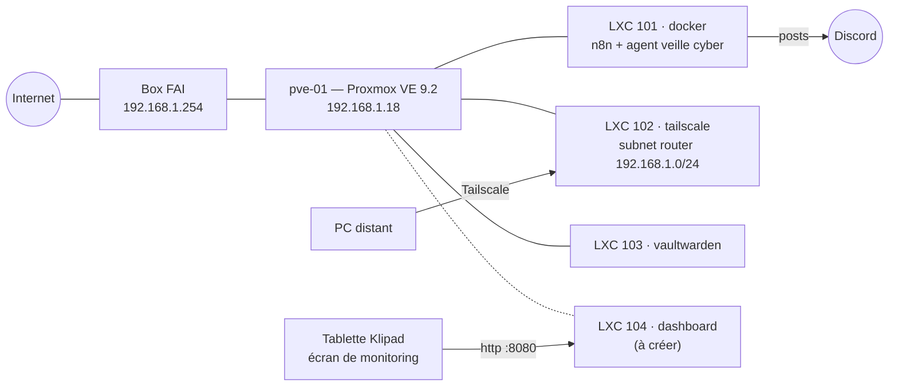

# Homelab pve-01

Homelab personnel sur un **HP ProLiant MicroServer Gen8** sous **Proxmox VE 9.2**.
Ce dépôt documente l'infrastructure, garde les fichiers de configuration et versionne
l'agent de veille cybersécurité (n8n).

> ⚠️ Aucun secret dans ce dépôt : jetons API, webhooks Discord, clés Gemini et mots de passe
> restent sur les machines (fichiers `.env`, ignorés par Git). Garde le dépôt **privé**.

## Vue d'ensemble



## Inventaire

| ID  | Nom          | Type | Rôle                                         | État        |
|-----|--------------|------|----------------------------------------------|-------------|
| —   | pve-01       | nœud | Hyperviseur Proxmox VE 9.2.21                 | en service  |
| 101 | docker       | LXC  | Docker → **n8n** (agent de veille cyber)      | en service  |
| 102 | tailscale    | LXC  | Accès distant (subnet router)                 | en service  |
| 103 | vaultwarden  | LXC  | Gestionnaire de mots de passe                 | en service  |
| 104 | dashboard    | LXC  | Tableau de bord pour la tablette              | à créer     |

Stockages : `local`, `local-lvm`, `vms-storage`. Zone SDN : `localnetwork`.

## Arborescence

```
docs/                    Documentation (matériel, réseau, Proxmox, monitoring, sécurité, journal)
proxmox/                 Fichiers de configuration de l'hôte (réseau, extraits de conf LXC)
services/
  n8n/                   docker-compose + .env.example pour le LXC 101
  tailscale/             Procédure du subnet router (LXC 102)
  vaultwarden/           Notes et sauvegarde (LXC 103)
  dashboard/             Tableau de bord léger pour la tablette (LXC 104)
agents/veille-cyber/     Agent n8n de veille cyber : architecture + workflow exporté
scripts/                 Export et nettoyage des workflows n8n
```

## Par où commencer

1. [docs/materiel.md](docs/materiel.md) — le serveur, la RAM à acheter, la tablette
2. [docs/reseau.md](docs/reseau.md) — adressage, passerelle, accès distant
3. [docs/proxmox.md](docs/proxmox.md) — conteneurs, stockage, jetons API, sauvegardes
4. [agents/veille-cyber/README.md](agents/veille-cyber/README.md) — l'agent de veille
5. [docs/journal.md](docs/journal.md) — problèmes rencontrés et décisions prises

## Prochaines étapes

- [ ] Passer la RAM de 2 Go à 16 Go (2 × HP 669324-B21)
- [ ] Installer n8n dans le LXC 101 et importer le workflow de veille
- [ ] Créer le LXC 104 et déployer le tableau de bord
- [ ] Brancher le heartbeat de l'agent sur le tableau de bord
- [ ] Mettre en place les sauvegardes Proxmox (vzdump) + copie hors site de Vaultwarden
- [ ] Compléter les adresses IP des conteneurs dans `docs/reseau.md`
