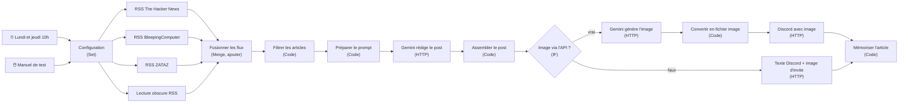

# Agent de veille cybersécurité

Workflow n8n qui lit plusieurs flux RSS de cybersécurité, sélectionne les articles,
fait rédiger un post par Gemini, génère une image et publie le tout sur Discord.

- Hébergement : n8n dans le LXC 101 (voir [services/n8n](../../services/n8n/README.md))
- Exécution : **lundi et jeudi à 10 h** (+ déclencheur manuel pour les tests)
- Sortie : un post Discord par exécution, avec image

## Schéma



## Nœuds

| # | Nœud                          | Type            | Rôle                                                         |
|---|-------------------------------|-----------------|--------------------------------------------------------------|
| 1 | Lundi et jeudi 10h            | Schedule        | Déclenchement automatique                                    |
| 2 | Manuel de test                | Manual Trigger  | Lancement à la main                                          |
| 3 | Configuration                 | Set (manuel)    | Paramètres communs (nombre d'articles, ton, langue…)          |
| 4 | RSS The Hacker News           | RSS Read        | Source 1                                                     |
| 5 | RSS BleepingComputer          | RSS Read        | Source 2                                                     |
| 6 | RSS ZATAZ                     | RSS Read        | Source 3 (francophone)                                       |
| 7 | Lecture obscure RSS           | RSS Read        | Source 4 — _préciser l'URL_                                   |
| 8 | Fusionner les flux            | Merge (append)  | Une seule liste d'articles                                   |
| 9 | Filtrer les articles          | Code            | Tri par date, doublons, articles déjà publiés                 |
| 10| Préparer le prompt            | Code            | Construit la consigne pour Gemini                             |
| 11| Gemini rédige le post         | HTTP Request    | Appel à l'API Gemini (texte)                                  |
| 12| Assembler le post             | Code            | Mise en forme du message Discord                              |
| 13| Image via l'API ?             | IF              | Bascule entre image générée et image de repli                 |
| 14| Gemini génère l'image         | HTTP Request    | Appel à l'API Gemini (image)                                  |
| 15| Convertir en fichier image    | Code            | Base64 → binaire pour l'envoi                                 |
| 16| Discord avec image            | HTTP Request    | Webhook Discord, multipart avec pièce jointe                  |
| 17| Texte Discord + image d'invite| HTTP Request    | Webhook Discord, texte seul                                   |
| 18| Mémoriser l'article           | Code            | Enregistre l'article publié (évite les doublons)              |

## Secrets nécessaires

À recréer dans n8n après un import (jamais dans ce dépôt) :

- **Clé API Gemini** → credential n8n (en-tête `x-goog-api-key`) plutôt que dans l'URL.
- **Webhook Discord** → credential ou variable n8n, pas en dur dans le nœud HTTP.

## Workflow exporté

Le fichier versionné est [`workflows/veille-cyber.json`](workflows/), **nettoyé** de ses secrets
par [`scripts/sanitize-n8n-workflow.py`](../../scripts/sanitize-n8n-workflow.py).

Pour le mettre à jour depuis l'interface n8n :

1. Ouvrir le workflow → menu **⋯ → Download** → enregistrer le fichier.
2. `python3 scripts/sanitize-n8n-workflow.py chemin/vers/export.json agents/veille-cyber/workflows/veille-cyber.json`
3. Vérifier le résultat (`git diff`), puis committer.

Ou en ligne de commande depuis le LXC 101 : [`scripts/export-n8n-workflows.sh`](../../scripts/export-n8n-workflows.sh).

## Lien avec le tableau de bord

Ajouter un nœud **HTTP Request** après « Mémoriser l'article » pour afficher l'agent sur la tablette :

- Méthode `POST`, URL `http://IP_DU_LXC_104:8080/api/heartbeat`
- Corps JSON :

```json
{
  "name": "veille-cyber",
  "status": "ok",
  "task": "Post publié le {{ $now.toFormat('dd/MM HH:mm') }}",
  "max_age": 360000
}
```

`max_age` = 100 h : l'agent ne tourne que deux fois par semaine (jeudi → lundi = 4 jours),
il ne passe donc en orange que s'il rate une exécution. Pour signaler une erreur, ajouter un
**Error Trigger** dans un workflow séparé qui envoie `"status": "error"`.

## Pistes d'amélioration

- Mémoriser les articles avec `$getWorkflowStaticData('global')` (persiste entre exécutions, pas en mode manuel).
- Limiter la taille de la mémoire (garder les 200 derniers liens).
- Gérer les erreurs de flux RSS (option « Continue On Fail ») pour qu'une source en panne ne bloque pas tout.
- Ajouter des sources : CERT-FR (cert.ssi.gouv.fr), CISA KEV, Krebs on Security.
